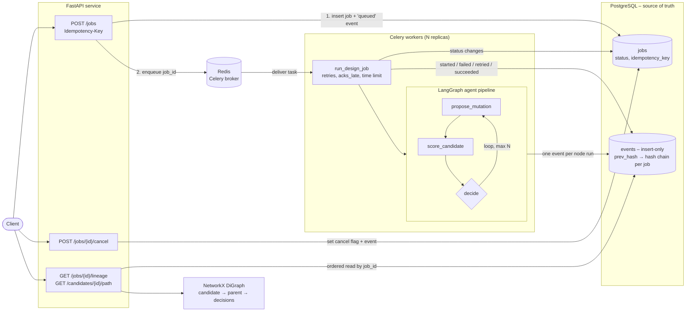

# provenance-jobs

A learning prototype of an **agentic job platform with data provenance**: long-running
"protein design" jobs run on background workers, and every decision they make is written
to a **tamper-evident, hash-chained audit trail** that stays consistent when jobs are
retried, cancelled or partially fail.

> Status: **Stages 1–3 and 5 done**: API, Celery worker, hash-chained audit trail,
> lineage benchmark (index vs no index).
> See [LEARNING_NOTES.md](LEARNING_NOTES.md) for what each stage teaches.

## Quick start

Works on Windows/macOS/Linux with only Docker (no `make` or local Python needed):

```bash
cp .env.example .env                    # PowerShell: Copy-Item .env.example .env
docker compose up -d --build --wait     # postgres, redis, api, worker - waits until healthy
docker compose ps                       # all four should be "healthy"

docker compose exec api pytest -q                           # unit tests (hash chain)
docker compose exec api python scripts/submit_jobs.py --cancel 2   # 10 jobs end to end
docker compose exec api python scripts/tamper.py            # break a chain, detect it, restore
docker compose exec api python scripts/benchmark_lineage.py # 100k events: lineage time with/without index

py scripts/resilience_demo.py           # ON THE HOST: kill the worker mid-run, check nothing is lost
                                        # (macOS/Linux: python3 scripts/resilience_demo.py)
docker compose logs -f worker           # watch retries/cancellations live
docker compose down                     # stop (keeps data); `down -v` deletes it
```

The API docs are at http://localhost:8000/docs. With `make`, the same steps are
`make up`, `make test`, `make submit` and `make tamper`.

### API

| Method | Path | Notes |
|---|---|---|
| `POST` | `/jobs` | Optional `Idempotency-Key` header. 201 = new job, 200 = existing job for that key |
| `GET` | `/jobs/{id}` | Job state |
| `GET` | `/jobs/{id}/lineage` | Events in order + `chain: {valid, first_broken_event_id, reason}` |
| `POST` | `/jobs/{id}/cancel` | queued/retrying → cancelled now; running → flag, worker stops between steps; finished → 409 |

Event types: `queued`, `started`, `step_completed`, `failed`, `retried`,
`cancel_requested`, `cancelled`, `succeeded`. Each one carries its `attempt` (0 = API).

## Architecture



### How a job flows

1. **Submit.** `POST /jobs` with an `Idempotency-Key` header. In one database
   transaction the API inserts the job and its first event (`queued`). Only then does
   it push the job id onto Redis. If the same key is sent again, the existing job is
   returned and nothing is queued twice.
2. **Execute.** A Celery worker takes the task from Redis and runs the agent pipeline
   (propose → score → decide). Each step is recorded as an event.
3. **Fail, retry, cancel.** Failures are retried with exponential backoff (max 3
   attempts). If a worker dies, `acks_late` makes Redis redeliver the task to another
   worker. A cancel request sets a flag that the task checks between steps. Every one
   of these transitions is an event, tagged with its `attempt` number.
4. **Audit.** Events are never updated or deleted. Each event stores
   `hash = SHA-256(prev_hash + canonical JSON)`, so editing any past row breaks every
   hash after it. `verify_chain(job_id)` recomputes the chain to detect this.
5. **Lineage.** The lineage endpoints read a job's events in order (indexed by
   `job_id`) and build a directed graph of candidates and decisions. Target: under 1 s
   over 10,000+ events.

### Responsibilities

| Component | Role | If it dies… |
|---|---|---|
| **PostgreSQL** | Source of truth: job state and the audit trail | Nothing runs; nothing is lost (durable volume) |
| **Redis** | Transport only: queue of job ids waiting for a worker | AOF persistence keeps queued messages across restarts |
| **FastAPI** | Accepts and validates requests, serves lineage | Stateless: restart it or run more replicas |
| **Celery worker** | Runs jobs and writes events | `acks_late`: the unfinished task is delivered again |

The key rule: **Redis can lose or duplicate a message and the audit trail must still be
correct.** Everything that matters is written to Postgres.

## Repository layout

```
provenance-jobs/
├── app/                 # Python package: API, models, worker, provenance, agent (Stages 1–4)
├── tests/               # pytest suite (Stages 1–8)
├── scripts/             # benchmark and resilience demo (Stages 5–6)
├── docker-compose.yml   # postgres + redis now; api, worker, prometheus, grafana later
├── .env.example         # configuration template → copy to .env
├── Makefile             # common commands (`make help`)
└── LEARNING_NOTES.md    # concepts, decisions and interview Q&A per stage
```

## Stack

Python 3.12 · FastAPI · SQLAlchemy 2.0 · Celery · Redis · PostgreSQL 16 · LangGraph ·
NetworkX · Docker Compose · Prometheus · Grafana · GitHub Actions
